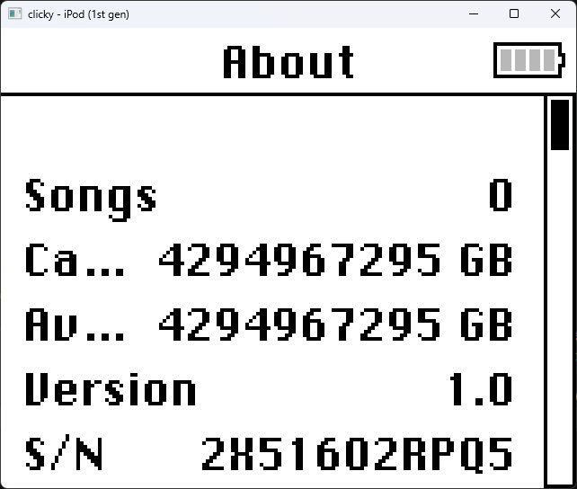
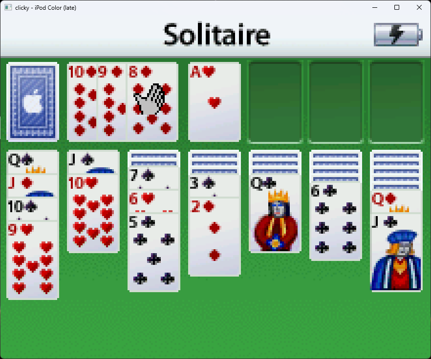
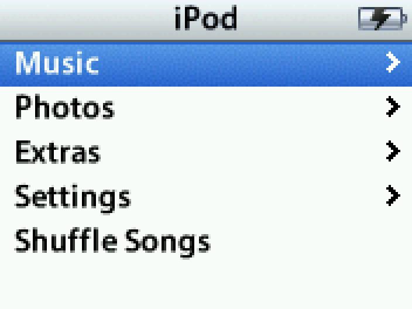

    
    <h1>clicky</h1>
    
A clickwheel iPod emulator.

    
<strong><a href="https://github.com/daniel5151/clicky/blob/master/docs/QUICKSTART.md">Quick Start</a> • <a href="https://github.com/daniel5151/clicky/blob/master/STATUS.md">Status</a> • <a href="https://github.com/daniel5151/clicky/blob/master/docs/DEVGUIDE.md">Development Guide</a> • <a href="https://discord.gg/kRmKZy7">Discord</a></strong>

---

**Current focus:** Fixing RetailOS emulation bugs on an emulated [iPod 4G (Grayscale)](https://everymac.com/systems/apple/ipod/specs/ipod_4thgen.html).

Here are some clips:

<table>
  <tr>
    <td></td>
    <td></td>
  </tr>
  <tr>
    <td width="320px">Booting <code>ipodloader2</code> (a third-party bootloader for the iPod)</td>
    <td width="320px">Successfully booting into <a href="https://www.rockbox.org/"><code>Rockbox</code></a></td>
  </tr>
</table>

<table>
  <tr>
    <td></td>
    <td></td>
  </tr>
  <tr>
    <td width="320px">Playing Brick in <code>RetailOS</code></td>
    <td width="320px">RetailOS 1.0</code></td>
  </tr>
</table>
<table>
  <tr>
    <td></td>
    <td></td>
  </tr>
  <tr>
    <td width="320px">iPod Color</code></td>
    <td width="320px">iPod Nano</code></td>
  </tr>
</table>

## Roadmap

-   [x] Boot into RetailOS
    - done :D

### Unknowns that might make things tricky

-   Funky cache effects
    -   I _really_ don't want to deal with implementing proper caching if I don't have to. I'm gonna cross my fingers, and hope that having both CPUs see memory writes at the same time will be _fiiiiine_
-   Funky iPod hardware that _hasn't_ been reverse engineered
    -   ...this will suck, and unfortunately, It's probably something I'll encounter once I start messing around with RetailOS.

### Things probably best left for later

-   USB
    -   This seems like a huge rabbit hole of complexity, and is something that probably isn't critical to the iPod's core functions. Stubbing things out will probably be fine...
-   Audio
    -   inb4 "but it's an iPod, it's literally an _audio player_"
    -   yeah, I know, but Audio is hard and finicky to get right, so I'll be leaving it for _waaaaaay_ later

---

## Fluff: Why emulate the iPod?

'cause it's a neat technical challenge! :smile:

Compared to my last big emulation project ([ANESE](https://prilik.com/ANESE), a NES emulator that [automatically maps out NES games](https://prilik.com/blog/wideNES)), the iPod presents a totally different set of technical challenges to overcome.

First of all, the iPod is a fairly modern system. Unlike the esoteric and custom-made chips used in many game consoles, the iPod uses many off-the-shelf commodity hardware and technologies. As such, this project should be a good way to explore and learn more about the low level details of the ARM architecture, I2S, I2C, USB, IDE HDDs, etc...

Second of all, the iPod isn't very well documented! While this'll probably end up being more annoying than exciting in the long run, I'm excited to do my own research, discover new information, and consolidate information on the iPod myself (as opposed to already having a well organized and complete reference at my disposal \*cough\* the nesdev wiki \*cough\*). As it turns out, there's already quite a amount of documentation about the iPod that's floating around (thanks to the iPodLinux and Rockbox projects), but I'm sure there will still be plenty of stuff left for me to discover. Time to finally learn how to use [Ghidra](https://ghidra-sre.org/) I guess!

Lastly, the iPod is a system that's never been emulated before! That means there usually won't be any sort of "escape hatch" when I get stuck, since there's no one else's code I can peek at. Whatever challenges I run in to will be challenges I'm going to have to solve myself! How exciting!

...there is one last reason I want to emulate the iPod though:

**It's got _Brick Breaker!_**

> _ooooooh Brick Breaker baybeeeeee! This game has won game of the year, I don't know how many times!_

But seriously, aside from brick breaker, there were actually a whole bunch of [iPod Games](https://en.wikipedia.org/wiki/IPod_game) released for late-gen iPod models \~2006. While these games aren't necessarily _masterpieces_, they're still pretty neat, and aught to be preserved.

In fact, my initial inspiration for starting this project was actually hearing about these old games, and how no one has ever looked into preserving them. While getting these games working will probably take quite a while, it's a neat long-term goal to aim for.

## Thanks and Acknowledgments

This project would be dead in the waters without these folks and projects:

-   [The iPod Linux Project](http://www.ipodlinux.org/) - for invaluable iPod reverse engineering work
-   [Rockbox](https://www.rockbox.org/) - for additional iPod reverse engineering work (and preserving _years_ of IRC logs to search through)
-   [freemyipod](https://freemyipod.org) - for preserving past reverse engineering efforts on S5L iPods (Linux4Nano era) and accomplishing the impossible (running Linux on a clickwheel iPod!)
-   [QEMU](https://www.qemu.org/) - for insights on how to structure the codebase, and how certain devices aught to work
-   [Sean Purcell](https://github.com/iburinoc/) - for writing the bulk of [armv4t_emu](https://github.com/daniel5151/armv4t_emu)
